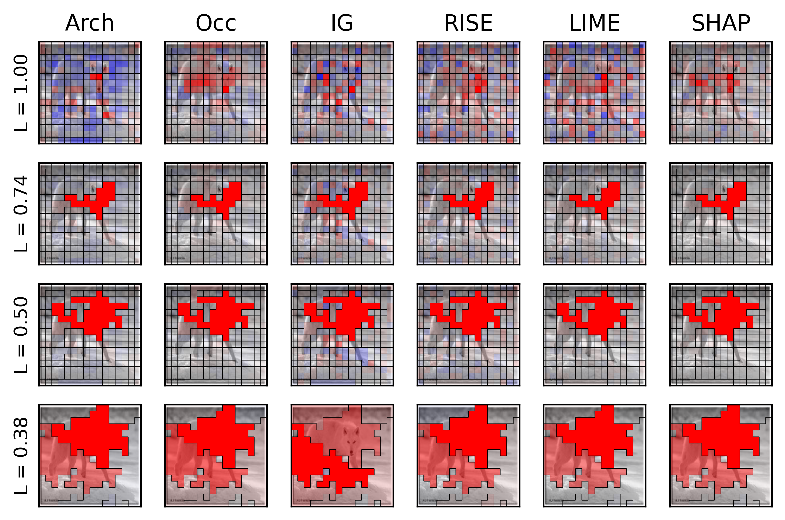

# AGREED : Adaptive Grouping to REduce Explanation Disagreements

## Description

<div style="text-align: center;">
  
</div>

This repository contains the source code to reproduce the experiments from the paper
[Tackling the XAI Disagreement Problem with Adaptive Feature Grouping](https://openreview.net/forum?id=RClKXngVN8), published at ICLR 2026.
The paper proposes a new algorithm, AGREED, that increases the agreement between explanabiliy methods
on tabular and image data by partitioning the input features into disjoint groups.

## Installation

### Install Pyenv

This project uses `pyenv` to control the version of python used.

<details>
<summary>Linux</summary>

> Note: Read pyenv documentation and ensure that you have all the suggested dependencies : https://github.com/pyenv/pyenv/wiki#suggested-build-environment

Install pyenv with:

```bash
curl https://pyenv.run | bash
```

Add those lines to your `~/.bashrc`

```bash
export PATH="~/.pyenv/bin:$PATH"
eval "$(pyenv init -)"
eval "$(pyenv virtualenv-init -)"
```

Then open a new shell or use `source ~/.bashrc`
</details>

<details>
<summary>OS X</summary>

Install pyenv with homebrew:

```bash
brew install pyenv
```

Add those lines to your `~/.bashrc`

```bash
eval "$(pyenv init -)"
eval "$(pyenv virtualenv-init -)"
```

Then open a new shell or use `source ~/.bashrc`
</details>


Once `pyenv` is installed, you can install a specific python version and
use it for this project.

```bash
pyenv install 3.10.14
pyenv local 3.10.14
```

This creates a `.python-version` file at the project root.

### Install Poetry & Dependencies

Poetry is used for dependency management. It specifies the project configuration and the
dependencies using the `pyproject.toml` file.

> Our installation of Pytorch used by default does not depends on cuda drivers.
> If you intend to use cuda, please make sure that the drivers are already installed on you
> machine. Afterward, you must uncomment part of the pyproject.toml to install torch with
> cuda dependencies.

<details>
<summary>Linux / OS X</summary>

**Install or Update poetry**
```bash
curl -sSL https://install.python-poetry.org | python3 -
```

Then open a new shell or use `source ~/.poetry/env`
</details>

To install the project dependencies and activate the virtual environment run
```bash
poetry config virtualenvs.in-projet true  # install the env in a local .venv folder
poetry install                            # Install the agreed package and its dependencies
source .venv/bin/activate                 # Activate the virtual environment
```

## Code Structure

The repository is structured as follows

```bash
experiments/
  README.md
  IntroCalifornia/   # Reproduce Figure 1
  TabularToy/        # Reproduce experiments of Section 5.1.1
  Tabular/           # Reproduce experiments of Section 5.1.2
  ImageToy/          # Reproduce experiments of Section 5.2.1
  MiniImageNet/      # Reproduce experiments of Section 5.2.2
agreed/              # Source code
  config/            # Configuration files
  dataset/           # Utilities to load tabular and image datasets
  models/            # Utilities to load image models
  explainers/        # Explain model predictions
    imagenet/        # Functions for imagenet
    images/          # Functions for arbitrary image datasets
    tabular/         # Functions for tabular data
```

For more information on how to run each experiment, refer to [experiments/README.md](experiments/README.md). 

## License
 
This project is licensed under the Non Production License – see the [LICENSE](LICENSE) file for details.

## Citations
This work was conducted by the scientists Gabriel Laberge and Ola Ahmad at CortAIx
Labs, and must be cited as follows

<pre>
@inproceedings{
    laberge2026tackling,
    title={Tackling the {XAI} Disagreement Problem with Adaptive Feature Grouping},
    author={Gabriel Laberge and Ola Ahmad},
    booktitle={The Fourteenth International Conference on Learning Representations},
    year={2026},
    url={https://openreview.net/forum?id=RClKXngVN8}
}
</pre>
